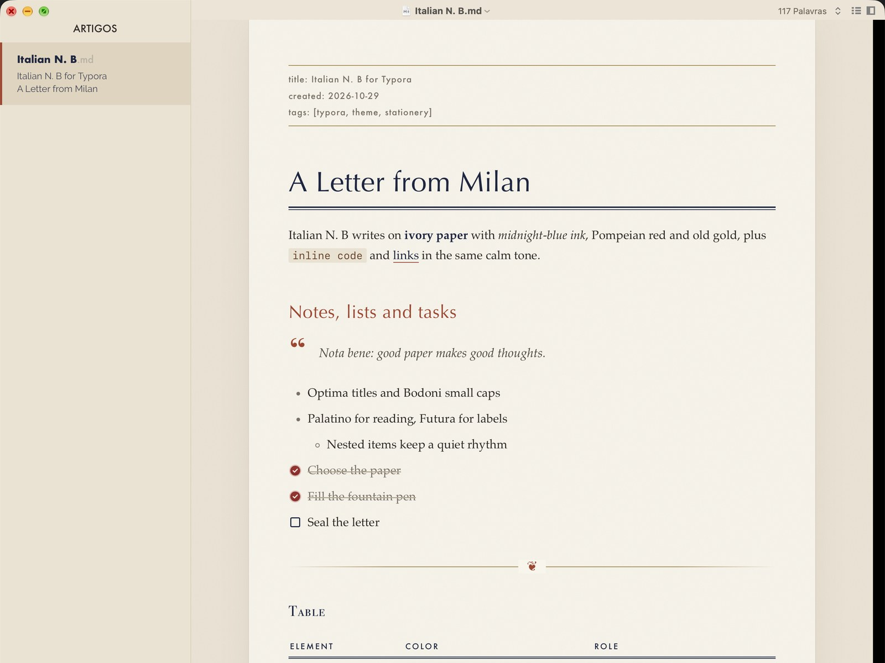

# Italian N. B for Typora

Vintage Italian stationery with a modern layout, a light theme for [Typora](https://typora.io). Ivory paper with a light grain, midnight-blue ink, Pompeian red and old gold.

## Features

- **Ivory paper** with a light grain, resting on a desk-colored background.
- **Classic Italian type**: Optima titles, Bodoni small caps, Palatino for reading and Futura for labels.
- **Front matter as a label** in Futura, between two old-gold rules.
- **Stationery details**: a double rule under the title, a fleuron on horizontal rules, a ledger margin for code blocks and checked tasks drawn as wax seals.
- **Print-friendly**: printing and PDF export drop the desk background.

## Installation

1. Download this repository (**Code → Download ZIP**) and unzip it.
2. In Typora, open **Preferences → Appearance → Open Theme Folder**.
3. Copy `italian-n.-b.css` into that folder.
4. Restart Typora and choose **Themes → Italian N. B**.

The file name looks odd on purpose: Typora shows `italian-n.-b.css` as "Italian N. B" and needs that exact name to load it.

## Fonts

All fonts ship with macOS: Optima, Bodoni 72, Palatino and Futura. Other systems fall back to Palatino Linotype, Georgia and Helvetica Neue.

## Notes

- Designed and tested on macOS with Typora 1.14. It should work on Windows and Linux, but it has not been tested there and does not include styles for the Windows "unibody" window style.

## License

[MIT](LICENSE) © 2026 kizei23
